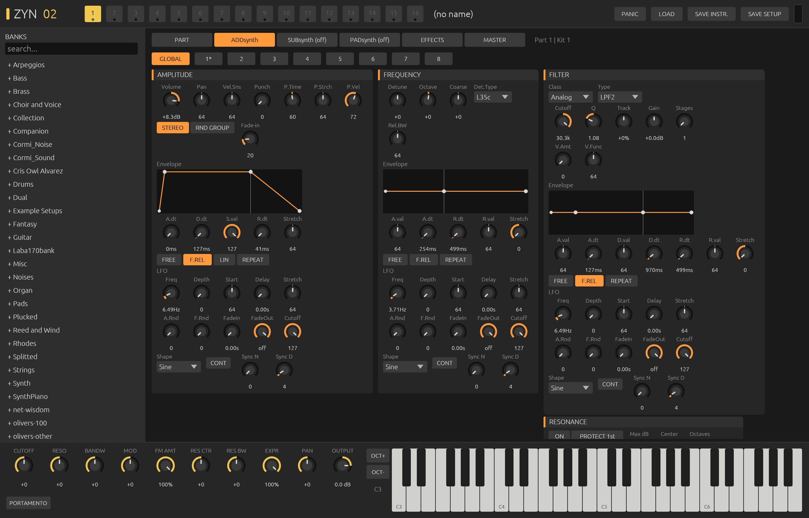

<div align="center">

# Zyn02

**ZynAddSubFX, rebuilt in Rust.**

*ADDsynth · SUBsynth · PADsynth · 16 parts × 16 kit items · the full Zyn effect rack · your .xiz and .xmz patches*

An Audio Unit, VST3 and CLAP instrument by **Jardim Sonoro**, written in Rust with
[truce](https://github.com/truce-audio/truce).



</div>

---

## The instrument

In 2002 Nasca Octavian Paul released [ZynAddSubFX](https://github.com/zynaddsubfx/zynaddsubfx),
a free synthesizer built on three ideas nobody else had put in one box: an
additive/subtractive engine whose oscillators are drawn harmonic by
harmonic, a subtractive engine that carves sound out of white noise with
banks of band-pass filters, and PADsynth, an algorithm that spreads every
harmonic over a band and renders the whole thing with one enormous inverse
FFT into a seamless, breathing wavetable. Two decades of musicians have
made thousands of patches for it.

Zyn02 (Zyn + 2002) is a port of that engine, module by module, from the
C++ sources (version 3.0.x) into Rust, wrapped as a modern plugin with a
new editor. It is not "Zyn-inspired": it loads the original patch files
and plays them the way ZynAddSubFX does.

## Same sound as the original — measured

The original was compiled locally and driven by a small harness through the
same note sequence as Zyn02, sample for sample (`tools/` in the history of
this repo; see *How it was checked* below).

| What | Result |
|---|---|
| All 1318 instruments in the bundled banks, instrument effects off | **862 bit-for-bit identical** (error < −40 dB, most at −120 dB) |
| The rest | statistically identical; they diverge only where the original is itself random or chaotic (see below) |
| Every effect × every factory preset × insertion/system | **bit-identical** (zero error), except 3 Distortion presets and 4 DynFilter presets at −75 to −110 dB |
| PADsynth wavetables | magnitude spectra **identical**; phases are random by design |
| Save → reload in Zyn02 | lossless on every tested patch (`cargo test`) |

Why the remaining instruments are not bit-identical:

- **PADsynth** fills its tables with random phases, a fresh set every time
  (in the original too).
- **Frequency modulation** integrates the modulator; a one-bit difference
  between FFTW (used by Zyn) and realfft (used here) in the oscillator table
  grows over a note. Envelopes and spectra stay the same.
- Some patches use Zyn's own randomness: random panning per note, the
  "Random" reverb type (comb lengths drawn at load), LFO randomness.

Faithfulness goes down to the quirks: Zyn's random generator and the order
in which notes consume it, the places where the C++ does one operation in
`double` in the middle of `float` code, the `normalize_max` bug in
PADsynth, the full-range random pan, version upgrades of old files
(volume scales, envelope dB fix for files older than 2.4.4, LFO frequency
before 3.0.4, filter parameters before 3.0.2, missing effect parameters
before 3.0.6), the pre-3.0.7 pan law.

## What is inside

```
 Part (×16) ── Kit item (×16) ──┬─ ADDsynth: 8 voices, each an OscilGen oscillator
                                │            + unison, FM / PM / ring / mix / PWM / sync,
                                │            voice filter, 5 envelopes, 3 LFOs
                                ├─ SUBsynth: up to 64 harmonics × 5 band-pass stages on noise
                                └─ PADsynth: harmonic profile → wavetables (built off the audio thread)
            └─ 3 instrument effects ─┐
 8 insertion effects ── 4 system effects (with sends) ── master volume / tuning
```

- **OscilGen**: 16 base functions + user waveform, 128 harmonics with
  magnitude/phase, oscillator filter (14 types), 17 waveshapers, spectrum
  adjust, harmonic shift, base-function and oscillator modulation,
  adaptive harmonics, resonance.
- **Filters**: analog biquads (9 types, up to 5 stages, smoothed cutoff),
  formant filter with vowel sequences, state-variable, Moog ladder, comb.
- **Effects**: Reverb, Echo, Chorus/Flanger, Phaser (classic and analog),
  AlienWah, Distortion, 8-band EQ, Dynamic Filter, with all factory
  presets. (Zyn 3.0.7's new Sympathetic and Reverse effects are not ported
  yet; patches using them load with that slot silent.)
- **Performance**: poly / mono / legato, portamento (constant or
  proportional, up/down stretch, thresholds), key and voice limits,
  sustain, velocity curves, microtonal scales and keyboard maps from .xmz.

## The editor

- **Header**: the 16 parts (click to edit, double-click to switch a part
  on/off, the dot lights with activity), load/save, panic, output meter.
- **Banks** (left): all 1318 instruments shipped with ZynAddSubFX plus its
  example setups, embedded in the plugin, with search. A click loads the
  instrument into the selected part.
- **Pages**, colour-coded like Zyn's own editor:
  **PART** (mode, volume, keys, MIDI channel, controllers, kit table) ·
  **ADDsynth** orange (global + 8 voices, oscillator designer with live
  waveform and spectrum, modulator, envelopes drawn and draggable) ·
  **SUBsynth** blue (harmonic and bandwidth bars) ·
  **PADsynth** violet (profile, bandwidth, quality; tables rebuild when you
  release the mouse) · **EFFECTS** · **MASTER** (volume, transpose, tuning).
- **Bottom**: the host-automatable controls and a playable keyboard.

Knobs: drag up/down, Shift for fine, double-click for default, wheel to
nudge. Bars: drag to paint, right-click to reset a bar.

## Host parameters

The whole sound lives in the plugin state (saved as ZynAddSubFX XML, so a
DAW session can be exported and opened in the original). On top of it the
host sees a small performance layer that drives the controllers Zyn already
understands, on every part:

| Parameter | Zyn controller |
|---|---|
| Filter Cutoff, Filter Q | CC 74, CC 71 |
| Bandwidth | CC 75 |
| Mod Wheel | CC 1 |
| FM Amount | CC 76 |
| Resonance Center, Resonance Bandwidth | CC 77, CC 78 |
| Expression, Panning | CC 11, CC 10 |
| Portamento | CC 65 |
| Output | gain after the engine |
| Engine Buffer, PAD Interpolation | settings |

MIDI: notes, velocity, polyphonic aftertouch, pitch bend, every
controller above plus sustain (64), all notes off (123), all sounds off
(120), reset controllers (121). Each part listens to its own MIDI
channel, as in Zyn.

## Install (macOS, Apple Silicon)

1. Download `Zyn02-macOS-arm64.zip` from [Releases](../../releases) and unzip it.
2. Copy the formats your DAW uses:
   - `Zyn02.component` → `~/Library/Audio/Plug-Ins/Components/` (Logic, Ableton Live, GarageBand)
   - `Zyn02.vst3` → `~/Library/Audio/Plug-Ins/VST3/`
   - `Zyn02.clap` → `~/Library/Audio/Plug-Ins/CLAP/`
3. The bundles are ad-hoc signed, not notarized. Clear the quarantine once:
   ```sh
   cd ~/Library/Audio/Plug-Ins
   xattr -dr com.apple.quarantine Components/Zyn02.component VST3/Zyn02.vst3 CLAP/Zyn02.clap
   ```
4. Rescan plug-ins in your DAW: *Jardim Sonoro › Zyn02*.

## Build from source

```sh
cargo install cargo-truce
cargo truce install --au2        # build + install the Audio Unit
cargo truce install              # every format
cargo truce run                  # standalone app
cargo test --release             # save/reload round trip over the banks
cargo run --release --example render -- banks/Pads/0003-Analog\ Pad\ 1.xiz out.wav 48 55 60 64
```

`auval` passes.

| Path | What lives there (and the C++ file it follows) |
|---|---|
| `src/synth/oscilgen.rs` | `Synth/OscilGen.cpp` |
| `src/synth/adnote.rs`, `ad_params.rs` | `Synth/ADnote.cpp`, `Params/ADnoteParameters.cpp` |
| `src/synth/sub.rs` | `Synth/SUBnote.cpp`, `Params/SUBnoteParameters.cpp` |
| `src/synth/pad.rs` | `Synth/PADnote.cpp`, `Params/PADnoteParameters.cpp` |
| `src/synth/filter.rs`, `modfilter.rs` | `DSP/*Filter.cpp`, `Synth/ModFilter.cpp` |
| `src/synth/envelope.rs`, `lfo.rs` | `Synth/Envelope.cpp`, `Synth/LFO.cpp` and their params |
| `src/synth/effects.rs` | `Effects/*.cpp`, `DSP/Unison.cpp` |
| `src/synth/part.rs`, `master.rs` | `Misc/Part.cpp`, `Containers/NotePool.cpp`, `Misc/Master.cpp` |
| `src/synth/xml.rs` | `Misc/XMLwrapper.cpp` |
| `src/state.rs` | shared patch, loader / PAD builder / state writer thread, banks |
| `src/ui/` | the editor |
| `banks/`, `examples-xmz/` | the instrument banks and example setups of ZynAddSubFX |

## How it was checked

ZynAddSubFX was built from source twice: as released (`-O3 -ffast-math`)
and with strict IEEE arithmetic (`-O2 -ffp-contract=off`). A C++ harness
loads an instrument into a `Part`, plays the same notes at the same block
boundaries as `examples/render.rs`, and writes raw samples; both random
generators are seeded with 0x1234 before the first note. A second harness
runs every effect preset on a fixed test signal. The comparison against the
strict build is what the table above reports; against the fast-math build
the results are the same within rounding.

Engine timing follows Zyn's plugin builds: audio is computed in blocks of
the engine buffer (256 samples by default, selectable), and MIDI lands on
block boundaries.

## Credits

ZynAddSubFX: Nasca Octavian Paul, Mark McCurry and contributors (GPL-2.0 or
later); the bundled banks keep their authors' licences (see the files in
`banks/`). Framework: truce (MIT/Apache-2.0). Zyn02 is an independent port
and is not affiliated with the ZynAddSubFX project.

## License

Free software under the [GNU General Public License v3.0](LICENSE) or later
(ZynAddSubFX is GPL-2.0-or-later, which allows this).
